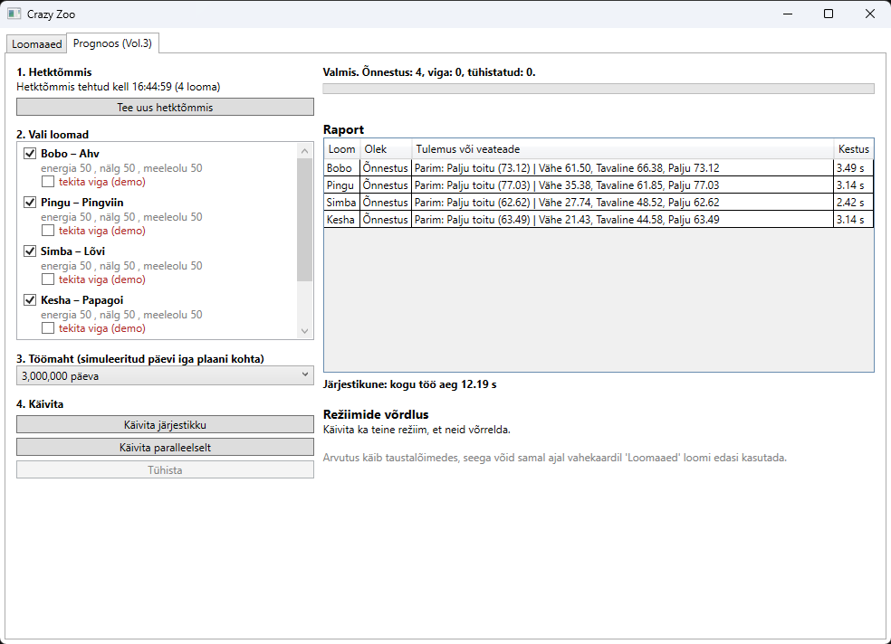
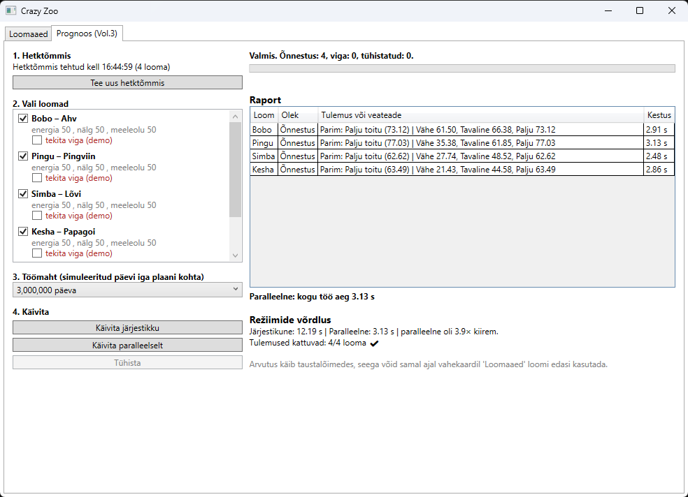
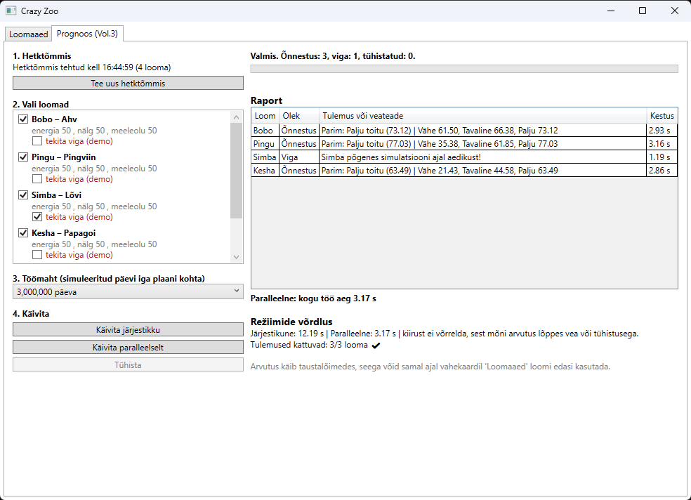
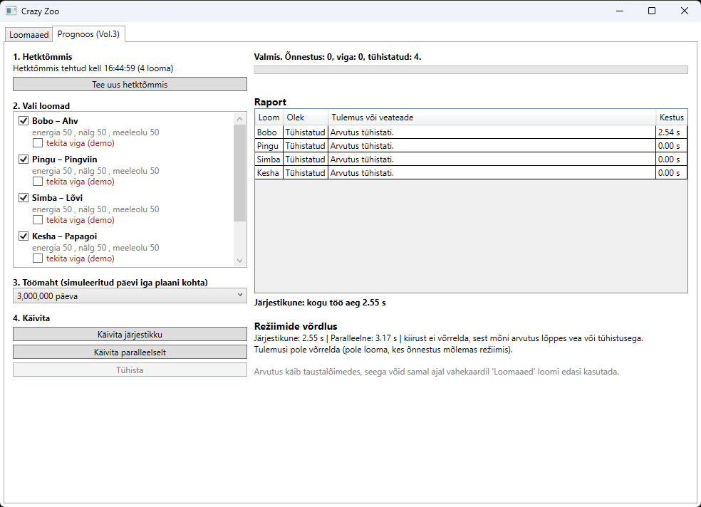
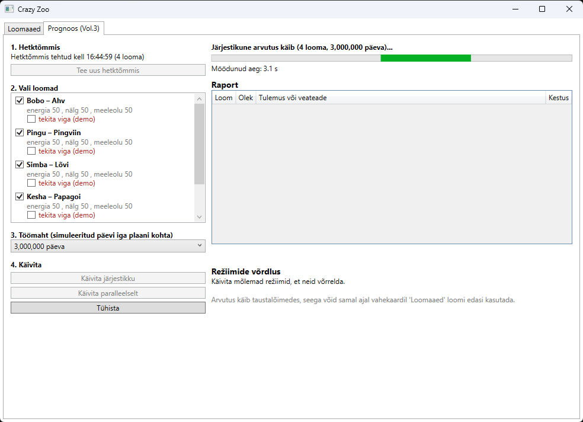

# Crazy Zoo

## Maailm ja eesmärk
Humoorikas WPF-rakendus, kus ahv, pingviin, lõvi, papagoi, delfiin, elevant ja orav elavad samas loomaaias,
aga käituvad erinevalt. Eesmärk on harjutada pärilust, liideseid, polümorfismi,
üldtüüpe (generics), sündmusi, LINQ-i, MVVM-i, paralleelset arvutust ning
maailma salvestamist (JSON, XML, LocalDB) ja Dependency Injectionit.

## Käivitamine
1. `git clone https://github.com/Nksje/CrazyZoo.git`
2. Ava `CrazyZoo.slnx` Visual Studios (.NET 10)
3. Määra `CrazyZoo.Wpf` startup-projektiks ja vajuta F5.
   NuGet-paketid (`Microsoft.Extensions.DependencyInjection`, `Microsoft.Data.SqlClient`) taastatakse automaatselt.
4. Vaikimisi salvestatakse JSON/XML failidesse. LocalDB kasutamiseks vaata „Vol.4 → Käivitusjuhend (LocalDB)”.

## Projekti struktuur
- `CrazyZoo.Core` – domeeniloogika (loomad, rühmad/hoidlad, sündmused, LINQ). Ei sõltu WPF-ist.
  - `Forecast/` – Vol.3 prognoosiarvutus.
  - `Persistence/` – salvestatavad andmed (`WorldDto`, `GroupDto`, `AnimalDto`), leping `IWorldStorage` ja `WorldMapper`.
- `CrazyZoo.Wpf` – kasutajaliides (View) ja ViewModelid (`MainViewModel`, `ForecastViewModel`).
  - `Services/` – salvestusteostused (JSON, XML, LocalDB), failidialoogid ja seadistus (`appsettings.json`).
- `db/create.sql` – LocalDB andmebaasi ja tabelite loomine.
- `docs/vol4/` – vigased failid laadimise vigade demonstreerimiseks.

## Klassihierarhia
- `Animal` (abstract) → `Monkey`, `Penguin`, `Lion`, `Parrot`, `Dolphin`, `Elephant`, `Squirrel`
- `ISwimmable` – Monkey, Penguin, Dolphin; `IClimb` – Monkey, Squirrel; `IFly` – Penguin, Parrot
- Monkey ja Penguin rakendavad kahte rolli.
- `IRepository<T>` / `Repository<T> where T : Animal` – tüübipõhine hoidla (Add, Remove, GetAll, Find)
- `AnimalSection<T>` – üks rühm = üks tüübipõhine hoidla `Repository<T>`. Igal rühmal on `Id` ja nimi.
  Ühel tüübil võib olla mitu rühma (nt „Ahvid A” ja „Ahvid B”), kumbki on eraldi `Repository<Monkey>`.
- `ZooWorld` – kõik rühmad, loomade ja rühmade ID-de jagamine, rühma vahetus (`Move`).
- `AnimalTypes` – ainus koht, kus tüübi võti (`"Monkey"`) seotakse klassiga ja tema hoidlaga.
- `ZooQueries` – LINQ-päringud

## CrazyAction ja olekureeglid
- Igal loomal on unikaalne `Id`, mis jääb samaks ka pärast salvestamist, laadimist ja rühma vahetust.
- Energia, nälg ja meeleolu on 0..100, muuta saab ainult meetodite kaudu (private set).
- Monkey: varastab banaani (nälg ↓, energia ↓), vajab energiat ≥ 10.
- Penguin: libiseb kõhuli (energia ↓).
- Lion: ajab saba taga (vajab energiat ≥ 30, muidu olek ei muutu).
- Parrot: imiteerib valvurit (vajab energiat ≥ 15, energia ↓, nälg ↑).
- Vigane sisend ei muuda looma olekut.

## Hoidlad, sündmused ja reaktsioonid
Iga loomatüüp elab oma hoidlas. Vale tüüpi looma lisamist takistab `where T : Animal`
ja tüübikontroll kompileerimisel, mitte UI nimevõrdlus.

Hoidla annab kolm sündmust (`AnimalEventArgs` sisaldab looma, kes tegevuse põhjustas):
- **Lisamine** (`ItemAdded`): sama hoidla senised loomad tervitavad uut looma. Uus loom ei tervita ennast.
- **Eemaldamine** (`ItemRemoved`): allesjäänud loomad jätavad eemaldatuga hüvasti. Eemaldatud loom lõpetab tellimise.
- **CrazyAction** (`ItemCrazyAction`): teised sama hoidla loomad reageerivad. Põhjustaja ei reageeri.
  Kui loom keeldus (olek ei muutunud), siis keegi ei reageeri.

Teise hoidla loomad ei reageeri. Iga reaktsioon kirjutab logisse rea ja muudab reageerija olekut
(`Mood` ja `ReactionCount`). Monkey, Penguin ja Lion reageerivad erinevalt (`override`).

Reaktsioonid toimuvad rühma sees: teise rühma loomad (ka sama tüüpi) ei reageeri.
**Rühma vahetus** (`ZooWorld.Move`): loom eemaldatakse vanast rühmast (seal jäetakse hüvasti)
ja lisatakse uude rühma (seal tervitatakse). Looma saab viia ainult sama tüüpi rühma.

## LINQ
Kolm päringut (vahekaardid UI-s), mis töötavad kõigi hoidlate loomadel:
- **Where**: otsing nime või liigi järgi.
- **OrderByDescending**: loomad energia järgi.
- **GroupBy**: loomade arv igas liigis.

## MVVM
- **Model/Core**: loomad, hoidlad, sündmused, reaktsioonid, LINQ (`CrazyZoo.Core`, ei sõltu WPF-ist).
- **ViewModel**: `MainViewModel` (valitud rühm ja loom, loendid, logi, päringute tulemused,
  `ICommand`-käsud, `INotifyPropertyChanged`, `ObservableCollection`).
  Salvestusteenused saab ta DI kaudu konstruktorist.
- **View**: `MainWindow.xaml` on seotud binding'ute kaudu, kooditaguses pole äriloogikat.
- `RelayCommand.CanExecute` keelab nupu, kui looma pole valitud või sisend on vigane.

## Kontrollitud kasutusjuhud
1. Loomale tühja nime andmine → veateade, looma ei looda.
2. Söötmine tekstiga "abc" või -5 → nupp on keelatud või tuleb veateade, olek ei muutu.
3. Lõvi CrazyAction väsinult → keeldub, energia ei muutu.
4. Lõvile "Ujuda" → "ei oska ujuda" (is-kontroll).
5. Loomade lisamine ja eemaldamine → list uueneb.
6. Samas hoidlas on A ja B, lisatakse C → A ja B tervitavad, C mitte.
7. C CrazyAction → A ja B reageerivad, C mitte.
8. B eemaldamine → A ja C jätavad hüvasti, B enam ei reageeri.
9. Teise hoidla loomade olek ja logi ei muutu punktides 6–8.
10. Väsinud Lõvi CrazyAction (keeldub) → teised loomad ei reageeri.
11. Looma viimine teise rühma → vana rühm jätab hüvasti, uus rühm tervitab, ID jääb samaks.
12. Salvestamine JSON-i/XML-i ja laadimine pärast taaskäivitust → samad ID-d, tüübid, väljad ja rühmad.
13. Vigase või sobimatu faili laadimine → veateade logis, senine maailm jääb alles.
14. Salvestamine LocalDB-sse ja laadimine pärast taaskäivitust → sama seis taastub.

## Iseseisvalt õpitud UI elemendid
Kasutasin **DataTemplate** (loomade ilus kuvamine listis ilma ToString'ita),
**ProgressBar** (energia, nälja ja meeleolu visuaalne näitamine, sobib olekule 0..100)
ja **TabControl** (logi ja kolm LINQ-päringut eraldi vahekaartidel).

## Vol.3: paralleelne arvutus (vahekaart „Prognoos (Vol.3)”)

Pull request: <https://github.com/Nksje/CrazyZoo/pull/5>

### Mida arvutatakse
Iga valitud looma jaoks võrreldakse kolme hooldusplaani (**Vähe toitu**, **Tavaline**, **Palju toitu**).
Iga plaani jaoks simuleeritakse looma päeva (24 tundi: uni, söögikorrad, juhuslikud CrazyAction'id)
miljoneid kordi ja arvutatakse keskmine heaolu. Tulemus: parim plaan ja kõigi plaanide keskmised.
See on puhas CPU-töö (`CrazyZoo.Core/Forecast/ForecastCalculator.cs`).

### Kuidas see töötab
- **Hetktõmmis**: `Animal.CreateSnapshot()` teeb looma andmetest koopia (`AnimalSnapshot`).
  Arvutus kasutab ainult koopiat, seega taustalõimed ei puutu päris loomi.
  Sama hetktõmmis jääb kehtima, kuni vajutad „Tee uus hetktõmmis”, nii saavad mõlemad režiimid sama sisendi.
- **Järjestikune režiim**: `foreach` + `await`. Järgmine loom alustab alles siis, kui eelmine on valmis.
- **Paralleelne režiim**: iga loom käivitatakse `Task.Run`-iga ja kõiki oodatakse `Task.WhenAll`-iga.
- **Tühistamine**: üks `CancellationTokenSource`, mille token antakse kõigile arvutustele.
  Iga simulatsioonitsükkel kutsub `token.ThrowIfCancellationRequested()`.
- **Vead**: iga looma arvutus on oma `try/catch`-is (`ForecastRunner.RunOneAsync`), seega ühe looma
  viga läheb raportisse ja teised arvutused jätkuvad. Demo jaoks saab linnukesega „tekita viga” vea tekitada.
- **Aeg**: iga looma kestus ja kogu töö aeg mõõdetakse `Stopwatch`-iga.
- **UI reageerib**: arvutus käib taustalõimedes ja taimer näitab töö ajal möödunud aega.
  Samal ajal saab vahekaardil „Loomaaed” loomi edasi kasutada.

Raportis on iga looma kohta nimi, lõppolek (Õnnestus / Viga / Tühistatud), tulemus või veateade ja kestus,
lisaks kogu töö aeg. „Režiimide võrdlus” näitab mõlema režiimi aega ja kontrollib, kas tulemused kattuvad.

### Lühike käivitusjuhend
1. Käivita rakendus (`dotnet run --project CrazyZoo.Wpf` või Visual Studios F5).
2. Ava vahekaart **Prognoos (Vol.3)**.
3. Vali loomad (vaikimisi kõik) ja töömaht (nt 3 000 000 päeva).
4. Vajuta **Käivita järjestikku** ja oota tulemust.
5. Vajuta **Käivita paralleelselt**: võrdlus näitab kiirust ja „Tulemused kattuvad: 7/7 ✔” (kõik valitud loomad).
6. **Viga**: pane ühele loomale linnuke „tekita viga (demo)” ja käivita. See loom saab oleku „Viga”, teised õnnestuvad.
7. **Tühistus**: käivita suure töömahuga ja vajuta **Tühista**. Pooleli ja alustamata arvutused saavad oleku „Tühistatud”.

Kui lisad või muudad loomi vahekaardil „Loomaaed”, vajuta **Tee uus hetktõmmis**.

### Ekraanipildid
| Järjestikune | Paralleelne + võrdlus |
|---|---|
|  |  |

| Viga ühel loomal | Tühistus |
|---|---|
|  |  |

Töö ajal (UI reageerib, taimer jookseb): 

## Vol.4: maailma salvestamine ja taastamine

Pull request: <https://github.com/Nksje/CrazyZoo/pull/6>

### Mida salvestatakse
Maailma olek salvestatakse eraldi andmeobjektidesse (DTO), mitte aknaid, käske ega sündmuste tellimusi:
- `WorldDto` – failiversioon, rühmad ja loomad.
- `GroupDto` – rühma ID, nimi ja loomatüüp (`Monkey`, `Penguin`, `Lion`, `Parrot`, `Dolphin`, `Elephant`, `Squirrel`).
- `AnimalDto` – looma ID, tüüp, nimi, muutuvad väljad (`Energy`, `Hunger`, `Mood`, `ReactionCount`)
  ja rühmakuuluvus (`GroupId`).

`WorldMapper.ToDto` teeb maailmast andmete koopia. `WorldMapper.FromDto` kontrollib andmeid
ja loob **uue** maailma: õiged loomatüübid, nende `Repository<T>` hoidlad ja reaktsioonide tellimused.

### Laadimise kontroll
Enne maailma asendamist kontrollitakse, et:
- failiversioon on toetatud;
- rühmade ja loomade ID-d on positiivsed ega kordu;
- loomatüüp on tuntud ja sobib rühma tüübiga;
- looma rühm on olemas;
- energia, nälg ja meeleolu on 0..100, reaktsioonide arv ei ole negatiivne;
- nimi vastab samadele reeglitele nagu UI-s (mitte tühi, max 20 märki).

Vea korral kuvatakse logis arusaadav teade ja **senine maailm jääb alles**.
Nähtav maailm asendatakse alles pärast edukat lugemist ja kontrolli. Seejärel teavitab ViewModel UI-d
(rühmad, loomad, LINQ-päringud ja prognoosi hetktõmmis uuenevad).

Laadimisel lisatakse loomad hoidlasse ilma sündmusteta (`Repository.Restore`), seega loomad ei tervita
üksteist uuesti ning salvestatud `Mood` ja `ReactionCount` ei muutu. Reaktsioonide tellimused luuakse siiski,
nii et pärast laadimist töötavad tervitused, hüvastijätud ja CrazyAction-reaktsioonid nagu enne.

### Salvestusteostused (sama leping `IWorldStorage`)
```csharp
public interface IWorldStorage
{
    Task SaveAsync(WorldDto world, string path, CancellationToken token = default);
    Task<WorldDto> LoadAsync(string path, CancellationToken token = default);
}
```
- `JsonWorldStorage` – `System.Text.Json`.
- `XmlWorldStorage` – `XmlSerializer` (`XmlRoot`, `XmlAttribute`, `XmlArray`, `XmlArrayItem`).
- `FileWorldStorage` – failirežiimi teostus, valib faililaiendi järgi JSON-i või XML-i.
- `SqlWorldStorage` – LocalDB ja ADO.NET (`Microsoft.Data.SqlClient`). Siin on `path` maailma nimi andmebaasis (`default`).

Failitee valib dialoogiteenus (`FileDialogLocationPicker`: `SaveFileDialog` / `OpenFileDialog`).
Faili lugemine ja kirjutamine toimub ainult salvestusteenuses.

### Dependency Injection
`App.xaml.cs` registreerib teenused `ServiceCollection`-is (`Microsoft.Extensions.DependencyInjection`).
Salvestusteostus valitakse käivitamisel failist `CrazyZoo.Wpf/appsettings.json`:
```json
{
  "Storage": "File",
  "ConnectionString": "Server=(localdb)\\MSSQLLocalDB;Database=CrazyZoo;Integrated Security=true;TrustServerCertificate=true"
}
```
- `"File"` → `IWorldStorage` = `FileWorldStorage` (JSON + XML), failitee küsitakse dialoogiga.
- `"Sql"` → `IWorldStorage` = `SqlWorldStorage`, maailma nimi on `default`.

`MainViewModel` saab `IWorldStorage` ja `IStorageLocationPicker` sõltuvuse konstruktorist ega tea, kas kasutatakse
faili või andmebaasi. `MainWindow` saab ViewModeli konstruktorist (`StartupUri` on App.xaml-ist eemaldatud).
UI-s näitab rida „Teostus (DI): …”, milline teostus valiti.

### LocalDB ja ADO.NET
Tabelid:
- `Worlds` – salvestatud maailm (`Id`, `Name`, `Version`, `SavedAt`).
- `AnimalGroups` – rühmad (primaarvõti `WorldId` + `Id`, `WorldId` on välisvõti tabelile `Worlds`).
- `Animals` – loomad (primaarvõti `WorldId` + `Id`, (`WorldId`, `GroupId`) on välisvõti tabelile `AnimalGroups`,
  `CHECK`-piirangud väärtustele 0..100).

Kõik SQL-laused kasutavad parameetreid (`@name`, `@id` jne). Salvestamine toimub **ühe tehinguna**:
maailma rida, vanade rühmade ja loomade kustutamine ning uute lisamine. `Commit` kinnitab kõik,
vea korral `Rollback` tühistab muudatused ja andmebaasi ei jää poolikut salvestust.
Andmebaasist laadimisel kasutatakse sama `WorldMapper.FromDto` kontrolli nagu failide puhul.

### Käivitusjuhend (LocalDB)
1. **Eeldus**: SQL Server Express LocalDB (tuleb Visual Studioga, töökoormus „Data storage and processing”).
2. Kontrolli ja käivita instants:
   ```
   sqllocaldb info MSSQLLocalDB
   sqllocaldb start MSSQLLocalDB
   ```
3. Loo andmebaas ja tabelid:
   ```
   sqlcmd -S "(localdb)\MSSQLLocalDB" -i db\create.sql
   ```
   või ava `db/create.sql` Visual Studio SQL Server Object Exploreris ja käivita.
4. Muuda failis `CrazyZoo.Wpf/appsettings.json` väärtus `"Storage": "Sql"` ja käivita rakendus.
   Ühendusstring on samas failis.

### Demonstreerimine
1. Muuda maailma: lisa loom, sööda või lase puhata (olek muutub), vii loom teise rühma (nt „Ahvid A” → „Ahvid B”).
2. Vajuta **Salvesta maailm** ja salvesta `.json` fail, seejärel sama maailm `.xml` failina.
3. Sulge rakendus. Käivita uuesti ja vajuta **Laadi maailm**: laadi kumbki fail.
   Samad ID-d (`#1`, `#2` …), tüübid, väljad ja rühmad on taastatud.
4. Käivita taastatud maailmas **CrazyAction!**: sama rühma loomad reageerivad, teiste rühmade loomad mitte.
5. Laadi vigane fail kaustast `docs/vol4/`. Logis on veateade ja senine maailm jääb alles:
   - `vigane.json` – katkine JSON;
   - `vale-tyyp.json` – tundmatu loomatüüp `Dragon`;
   - `vale-vaartus.json` – energia 150;
   - `vale.xml` – faili sees on JSON, mitte XML.
6. Pane `appsettings.json` failis `"Storage": "Sql"`, käivita, salvesta, sulge, käivita uuesti ja laadi:
   sama seis taastub andmebaasist. Rida „Teostus (DI): SqlWorldStorage” näitab DI kaudu valitud teostust.

## Koostöö kaasüliõpilasega

Kaasüliõpilane: Egor Mikhailov (GitHub: Egokio)

### Minu projekt (kaasüliõpilane täiendas)
- Issue: <https://github.com/Nksje/CrazyZoo/issues/1>
- Pull request: <https://github.com/Nksje/CrazyZoo/pull/2>
- Ülesanne: lisada uus alamklass `Parrot : Animal` (IFly) koos CrazyAction'iga.

### Kaasüliõpilase projekt (mina täiendasin)
Repositoorium: https://github.com/Egokio/CarsWorld

**Kodutöö 2**
- Issue: https://github.com/Egokio/CarsWorld/issues/1
- Pull request: https://github.com/Egokio/CarsWorld/pull/2
- Ülesanne: lisada uus alamklass `Ambulance : Car`, mis rakendab `IRefuelable`,
  override'ib `Drive()` ja `CrazyAction()` ning valideerib kütusekoguse `ActionResult` abil.
- Töö tehti harus `feature/ambulance`, muudatused esitati pull request'iga,
  `main`/`master` harusse otse ei commit'itud.

**Kodutöö 3**
- Issue: https://github.com/Egokio/CarsWorld/issues/4
- Pull request: https://github.com/Egokio/CarsWorld/pull/5
- Ülesanne: lisada Cars World 2 projekti kolm uut tüüpi (`Ambulance`, `FireTruck`, `Taxi`).
  Kõik pärivad `Car`, igaühel on oma `Drive()` ja `CrazyAction()`, nad on registreeritud
  `Repository<T>`-sse (osalevad tervitus-, hüvastijätu- ja CrazyAction-reaktsioonides)
  ning lisatud MVVM-põhisesse WPF-kasutajaliidesesse (lisamine, valimine, kuvamine, eemaldamine).
- Töö tehti harus `feature/new-character-types`, muudatused esitati pull request'iga.

## Tehisintellekti kasutamine
Tööriist: Claude (Anthropic).

Milleks kasutasin:
- Git-töövoo (branch, commit, pull request, merge) samm-sammuliseks selgitamiseks.
- README koostamiseks.
- Vol.3 paralleelse arvutuse (`Task.Run`, `Task.WhenAll`, `CancellationToken`, `Stopwatch`) kirjutamiseks ja selgitamiseks.
- Vol.4 salvestamise (DTO-d, JSON, XML, LocalDB/ADO.NET, tehingud, DI) kavandamiseks, kirjutamiseks ja selgitamiseks.

Enda kontrollid ja muudatused:
- Lasin Claude'il selgitada, mida iga osa teeb ja kuidas see teiste osadega seostub, ning kontrollisin selle koodist üle.
- Tegin ise Git-sammud: commit, pull, merge ja push.
- Kompileerisin ja käivitasin rakenduse ning kontrollisin kasutusjuhud.
