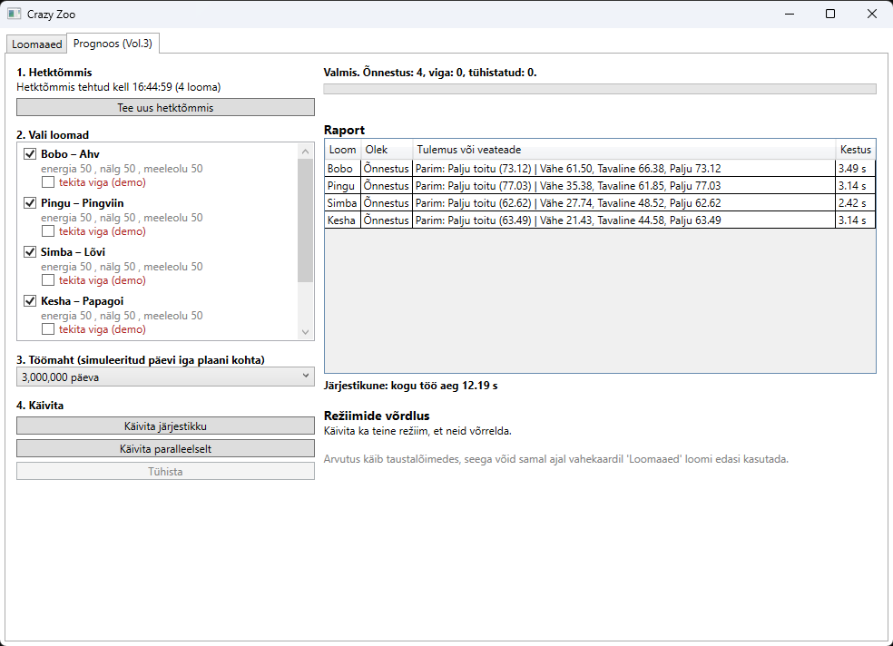
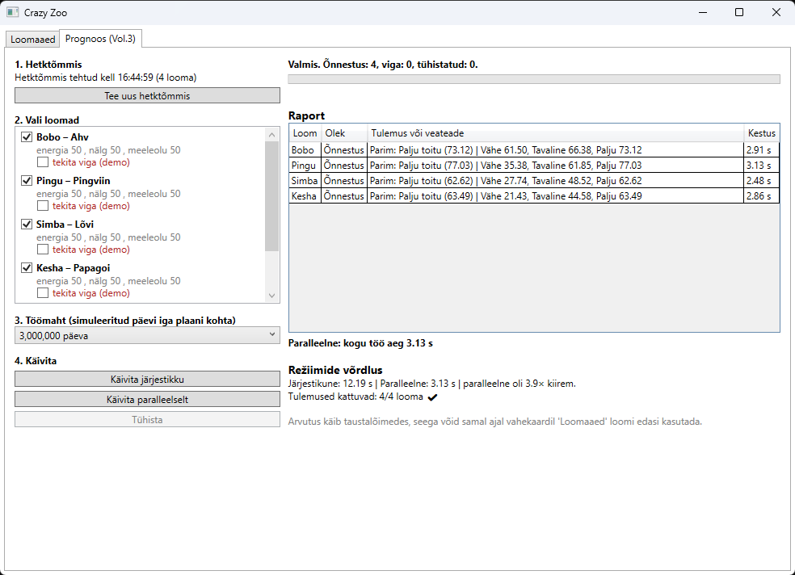
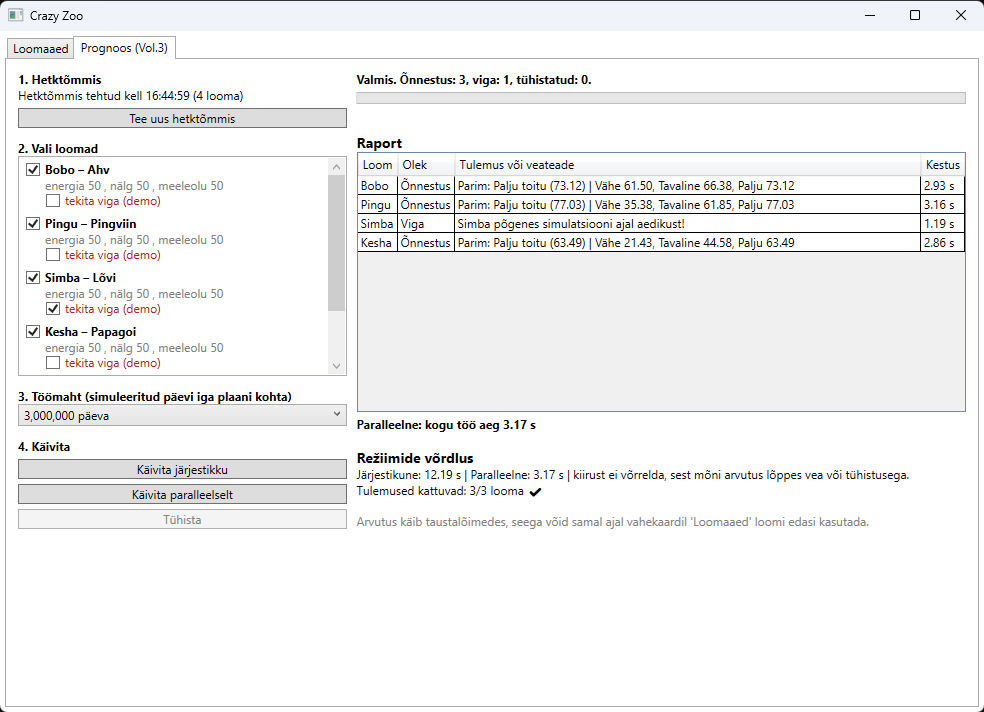
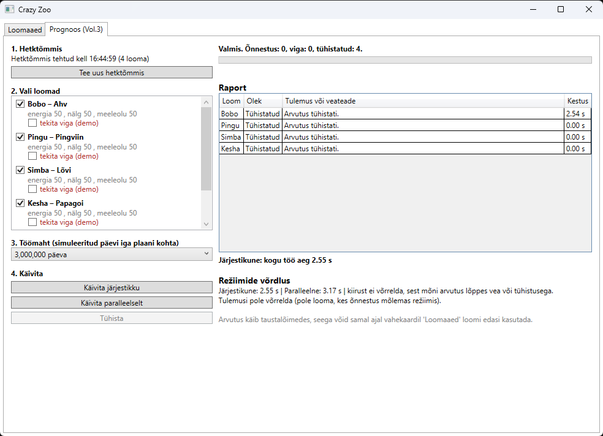
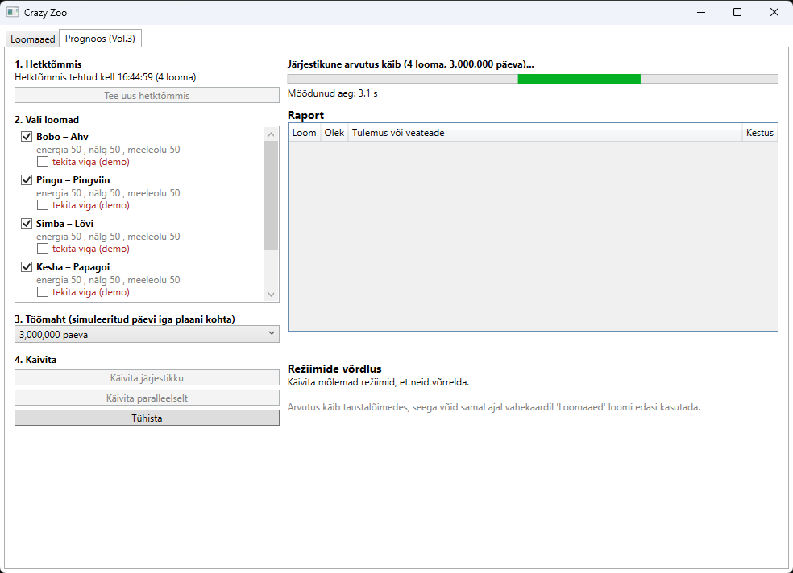

# Crazy Zoo

## Maailm ja eesmärk
Humoorikas WPF-rakendus, kus ahv, pingviin, lõvi ja papagoi elavad samas loomaaias,
aga käituvad erinevalt. Eesmärk on harjutada pärilust, liideseid, polümorfismi,
üldtüüpe (generics), sündmusi, LINQ-i ja MVVM-i.

## Käivitamine
1. `git clone https://github.com/Nksje/CrazyZoo.git`
2. Ava `CrazyZoo.slnx` Visual Studios (.NET 10)
3. Määra `CrazyZoo.Wpf` startup-projektiks ja vajuta F5.

## Projekti struktuur
- `CrazyZoo.Core` – domeeniloogika (loomad, hoidlad, sündmused, LINQ). Ei sõltu WPF-ist.
- `CrazyZoo.Wpf` – kasutajaliides (View) ja `MainViewModel` (ViewModel).

## Klassihierarhia
- `Animal` (abstract) → `Monkey`, `Penguin`, `Lion`, `Parrot`
- `ISwimmable` – Monkey, Penguin; `IClimb` – Monkey; `IFly` – Penguin, Parrot
- Monkey ja Penguin rakendavad kahte rolli.
- `IRepository<T>` / `Repository<T> where T : Animal` – tüübipõhine hoidla (Add, Remove, GetAll, Find)
- `AnimalSection<T>` ja `ZooWorld` – iga loomatüüp saab oma hoidla
  (`Repository<Monkey>`, `Repository<Penguin>`, `Repository<Lion>`, `Repository<Parrot>`)
- `ZooQueries` – LINQ-päringud

## CrazyAction ja olekureeglid
- Energia, nälg ja meeleolu on 0..100, muuta saab ainult meetodite kaudu (private set).
- Monkey: varastab banaani (nälg ↓, energia ↓), vajab energiat ≥ 10.
- Penguin: libiseb kõhuli (energia ↓).
- Lion: ajab saba taga (vajab energiat ≥ 30, muidu olek ei muutu).
- Parrot: imiteerib valvurit (vajab energiat ≥ 15, energia ↓, nälg ↑).
- Vigane sisend ei muuda looma olekut.

## Hoidlad, sündmused ja reaktsioonid
Iga loomatüüp elab oma hoidlas. Vale tüüpi looma lisamist takistab `where T : Animal`
ja tüübikontroll kompileerimisel, mitte UI nimevõrdlus.

Hoidla annab kolm sündmust (`AnimalEventArgs` sisaldab looma, kes tegevuse põhjustas):
- **Lisamine** (`ItemAdded`): sama hoidla senised loomad tervitavad uut looma. Uus loom ei tervita ennast.
- **Eemaldamine** (`ItemRemoved`): allesjäänud loomad jätavad eemaldatuga hüvasti. Eemaldatud loom lõpetab tellimise.
- **CrazyAction** (`ItemCrazyAction`): teised sama hoidla loomad reageerivad. Põhjustaja ei reageeri.
  Kui loom keeldus (olek ei muutunud), siis keegi ei reageeri.

Teise hoidla loomad ei reageeri. Iga reaktsioon kirjutab logisse rea ja muudab reageerija olekut
(`Mood` ja `ReactionCount`). Monkey, Penguin ja Lion reageerivad erinevalt (`override`).

## LINQ
Kolm päringut (vahekaardid UI-s), mis töötavad kõigi hoidlate loomadel:
- **Where**: otsing nime või liigi järgi.
- **OrderByDescending**: loomad energia järgi.
- **GroupBy**: loomade arv igas liigis.

## MVVM
- **Model/Core**: loomad, hoidlad, sündmused, reaktsioonid, LINQ (`CrazyZoo.Core`, ei sõltu WPF-ist).
- **ViewModel**: `MainViewModel` (valitud hoidla ja loom, loendid, logi, päringute tulemused,
  `ICommand`-käsud, `INotifyPropertyChanged`, `ObservableCollection`).
- **View**: `MainWindow.xaml` on seotud binding'ute kaudu, kooditaguses pole äriloogikat.
- `RelayCommand.CanExecute` keelab nupu, kui looma pole valitud või sisend on vigane.

## Kontrollitud kasutusjuhud
1. Loomale tühja nime andmine → veateade, looma ei looda.
2. Söötmine tekstiga "abc" või -5 → nupp on keelatud või tuleb veateade, olek ei muutu.
3. Lõvi CrazyAction väsinult → keeldub, energia ei muutu.
4. Lõvile "Ujuda" → "ei oska ujuda" (is-kontroll).
5. Loomade lisamine ja eemaldamine → list uueneb.
6. Samas hoidlas on A ja B, lisatakse C → A ja B tervitavad, C mitte.
7. C CrazyAction → A ja B reageerivad, C mitte.
8. B eemaldamine → A ja C jätavad hüvasti, B enam ei reageeri.
9. Teise hoidla loomade olek ja logi ei muutu punktides 6–8.
10. Väsinud Lõvi CrazyAction (keeldub) → teised loomad ei reageeri.

## Iseseisvalt õpitud UI elemendid
Kasutasin **DataTemplate** (loomade ilus kuvamine listis ilma ToString'ita),
**ProgressBar** (energia, nälja ja meeleolu visuaalne näitamine, sobib olekule 0..100)
ja **TabControl** (logi ja kolm LINQ-päringut eraldi vahekaartidel).

## Vol.3: paralleelne arvutus (vahekaart „Prognoos (Vol.3)”)

### Mida arvutatakse
Iga valitud looma jaoks võrreldakse kolme hooldusplaani (**Vähe toitu**, **Tavaline**, **Palju toitu**).
Iga plaani jaoks simuleeritakse looma päeva (24 tundi: uni, söögikorrad, juhuslikud CrazyAction'id)
miljoneid kordi ja arvutatakse keskmine heaolu. Tulemus: parim plaan ja kõigi plaanide keskmised.
See on puhas CPU-töö (`CrazyZoo.Core/Forecast/ForecastCalculator.cs`).

### Kuidas see töötab
- **Hetktõmmis**: `Animal.CreateSnapshot()` teeb looma andmetest koopia (`AnimalSnapshot`).
  Arvutus kasutab ainult koopiat, seega taustalõimed ei puutu päris loomi.
  Sama hetktõmmis jääb kehtima, kuni vajutad „Tee uus hetktõmmis”, nii saavad mõlemad režiimid sama sisendi.
- **Järjestikune režiim**: `foreach` + `await`. Järgmine loom alustab alles siis, kui eelmine on valmis.
- **Paralleelne režiim**: iga loom käivitatakse `Task.Run`-iga ja kõiki oodatakse `Task.WhenAll`-iga.
- **Tühistamine**: üks `CancellationTokenSource`, mille token antakse kõigile arvutustele.
  Iga simulatsioonitsükkel kutsub `token.ThrowIfCancellationRequested()`.
- **Vead**: iga looma arvutus on oma `try/catch`-is (`ForecastRunner.RunOneAsync`), seega ühe looma
  viga läheb raportisse ja teised arvutused jätkuvad. Demo jaoks saab linnukesega „tekita viga” vea tekitada.
- **Aeg**: iga looma kestus ja kogu töö aeg mõõdetakse `Stopwatch`-iga.
- **UI reageerib**: arvutus käib taustalõimedes ja taimer näitab töö ajal möödunud aega.
  Samal ajal saab vahekaardil „Loomaaed” loomi edasi kasutada.

Raportis on iga looma kohta nimi, lõppolek (Õnnestus / Viga / Tühistatud), tulemus või veateade ja kestus,
lisaks kogu töö aeg. „Režiimide võrdlus” näitab mõlema režiimi aega ja kontrollib, kas tulemused kattuvad.

### Lühike käivitusjuhend
1. Käivita rakendus (`dotnet run --project CrazyZoo.Wpf` või Visual Studios F5).
2. Ava vahekaart **Prognoos (Vol.3)**.
3. Vali loomad (vaikimisi kõik 4) ja töömaht (nt 3 000 000 päeva).
4. Vajuta **Käivita järjestikku** ja oota tulemust.
5. Vajuta **Käivita paralleelselt**: võrdlus näitab kiirust ja „Tulemused kattuvad: 4/4 ✔”.
6. **Viga**: pane ühele loomale linnuke „tekita viga (demo)” ja käivita. See loom saab oleku „Viga”, teised õnnestuvad.
7. **Tühistus**: käivita suure töömahuga ja vajuta **Tühista**. Pooleli ja alustamata arvutused saavad oleku „Tühistatud”.

Kui lisad või muudad loomi vahekaardil „Loomaaed”, vajuta **Tee uus hetktõmmis**.

### Ekraanipildid
| Järjestikune | Paralleelne + võrdlus |
|---|---|
|  |  |

| Viga ühel loomal | Tühistus |
|---|---|
|  |  |

Töö ajal (UI reageerib, taimer jookseb): 

## Koostöö kaasüliõpilasega

Kaasüliõpilane: Egor Mikhailov (GitHub: Egokio)

### Minu projekt (kaasüliõpilane täiendas)
- Issue: <https://github.com/Nksje/CrazyZoo/issues/1>
- Pull request: <https://github.com/Nksje/CrazyZoo/pull/2>
- Ülesanne: lisada uus alamklass `Parrot : Animal` (IFly) koos CrazyAction'iga.

### Kaasüliõpilase projekt (mina täiendasin)
Repositoorium: https://github.com/Egokio/CarsWorld

**Kodutöö 2**
- Issue: https://github.com/Egokio/CarsWorld/issues/1
- Pull request: https://github.com/Egokio/CarsWorld/pull/2
- Ülesanne: lisada uus alamklass `Ambulance : Car`, mis rakendab `IRefuelable`,
  override'ib `Drive()` ja `CrazyAction()` ning valideerib kütusekoguse `ActionResult` abil.
- Töö tehti harus `feature/ambulance`, muudatused esitati pull request'iga,
  `main`/`master` harusse otse ei commit'itud.

**Kodutöö 3**
- Issue: https://github.com/Egokio/CarsWorld/issues/4
- Pull request: https://github.com/Egokio/CarsWorld/pull/5
- Ülesanne: lisada Cars World 2 projekti kolm uut tüüpi (`Ambulance`, `FireTruck`, `Taxi`).
  Kõik pärivad `Car`, igaühel on oma `Drive()` ja `CrazyAction()`, nad on registreeritud
  `Repository<T>`-sse (osalevad tervitus-, hüvastijätu- ja CrazyAction-reaktsioonides)
  ning lisatud MVVM-põhisesse WPF-kasutajaliidesesse (lisamine, valimine, kuvamine, eemaldamine).
- Töö tehti harus `feature/new-character-types`, muudatused esitati pull request'iga.

## Tehisintellekti kasutamine
Tööriist: Claude (Anthropic).

Milleks kasutasin:
- Git-töövoo (branch, commit, pull request, merge) samm-sammuliseks selgitamiseks.
- README koostamiseks.
- Vol.3 paralleelse arvutuse (`Task.Run`, `Task.WhenAll`, `CancellationToken`, `Stopwatch`) kirjutamiseks ja selgitamiseks.

Enda kontrollid ja muudatused:
- Lasin Claude'il selgitada, mida iga osa teeb ja kuidas see teiste osadega seostub, ning kontrollisin selle koodist üle.
- Tegin ise Git-sammud: commit, pull, merge ja push.
- Kompileerisin ja käivitasin rakenduse ning kontrollisin kasutusjuhud.
- Oskan iga koodiosa selgitada ja vajadusel kohapeal muuta.
